<div align="center">




<br/>


<br/>

<!-- Replace SEU_USER / SEU_ID / SEU@EMAIL. Swap or delete badges you don't use. -->
<a href="https://linkedin.com/in/job-maria-958b4833a"></a>
<a href="https://x.com/SEU_USER"></a>
<a href="https://tryhackme.com/p/LORAX"></a>
<a href="mailto:jbmaria420@gmail.com"></a>

</div>

<br/>

```text
┌─ operator
│ id        Job Maria
│ focus     SOC and blue team (primary), red team, redes
│ build     Python, C, offensive tooling
│ rule      authorized scope only: labs, CTFs, bug bounty
│ status    ● online
└─────────────────────────────────────────────
```

## > mission

```text
$ cat mission.txt
```

I work the defensive side of security: detecting, investigating and responding to threats. I practice offensive techniques to learn what attacks actually look like in network traffic and logs, then turn that into better detection. Networking is the ground truth under all of it, and code is how I build the tools I need.

## > operating_loop

```text
detect ──▶ triage ──▶ contain ──▶ report
   ▲                                │
   └──────── tune detection ◀──────────┘
```

## > kill_chain

```text
$ diff red.log blue.log
```

| Phase (MITRE ATT&CK) | 🔴 Attack (red) | 🔵 Defend (blue) |
|---|---|---|
| Reconnaissance | Enumeration with Nmap, ffuf, Gobuster | Spot scanning patterns in network and web logs |
| Initial Access | Web application testing with Burp Suite | Alert on exploitation attempts and anomalous requests |
| Execution | Custom tooling in Python and C | Sigma rules for suspicious process and command activity |
| Discovery | Protocol and traffic analysis with Wireshark | Correlate network events, separate noise from signal |
| **Response** | | **Triage, investigation and containment per playbook** |

<!--
FEATURED PROJECTS: UNCOMMENT ONLY WHEN YOU HAVE REAL REPOS.
Steps: 1) replace FLAGSHIP_REPO and REPO_1..REPO_4 with real repo names,
2) fill in the flagship name and description, 3) remove this comment wrapper.

## > featured_projects

<div align="center">


### [FLAGSHIP_NAME](https://github.com/jobmaria/FLAGSHIP_REPO)

One objective line: what it solves and for whom.


<br/>

<a href="https://github.com/jobmaria420/PYTHON">
  
</a>

<br/><br/>

<a href="https://github.com/jobmaria/REPO_1"></a>
<a href="https://github.com/jobmaria/REPO_2"></a>
<br/>
<a href="https://github.com/jobmaria/REPO_3"></a>
<a href="https://github.com/jobmaria/REPO_4"></a>

<br/>

[all repositories →](https://github.com/jobmaria?tab=repositories)

</div>
-->

## > stack

<div align="center">


<br/><br/>


</div>

<!--
ACTIVITY AND STATS: UNCOMMENT ONLY WHEN THE ACCOUNT HAS REAL ACTIVITY.
Empty graphs hurt more than they help.

<div align="center">


</div>

<div align="center">


</div>
